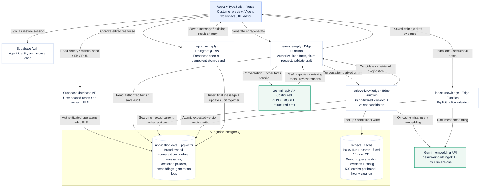

# CX Assist: current architecture

This diagram documents the implemented code and matches the Application flow view in the app. Layout differs for readability. It is not the Part 2 scale proposal or a live deployment-health report.

## Boundaries

- Customer mode is a testing view within agent authentication, not a separately authenticated customer portal.
- Browser operations use user tokens and RLS. Privileged backend writes require explicit authorization.
- Selected closed-session history is authorized by brand and customer, bounded, and snapshotted in the generation log.
- Retrieval caches candidates, not replies. Current text is reloaded under user permissions; revisions and expiry are checked.
- Citation validation verifies identifiers and exact quotes; policy interpretation is still probabilistic and requires agent review.
- Zero retrieval candidates produce a backend review fallback without a reply-model call. Embedding failures fall back to keyword search.
- Approval checks knowledge revision and latest message and atomically saves the final message and edits. Repeated approval returns the existing message.
- Indexing is explicitly triggered in the KB UI. The browser batch requires the page to remain open.
- No Redis, external message delivery, automatic refunds, auto-send, durable generation queue, or Realtime subscription is implemented.
